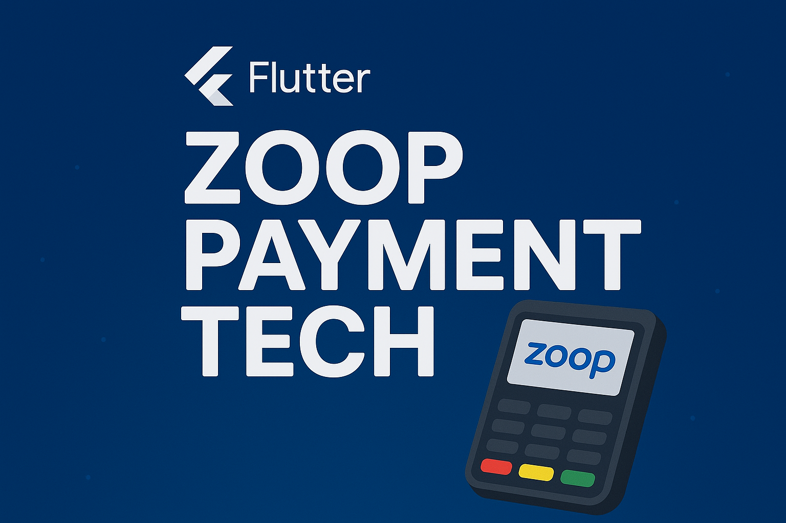

# zoop_payment_tech

> Unofficial, open source (MIT) Flutter plugin for the Zoop SmartPOS Android SDK: credit payments with installments, PIX, terminal activation and void on PAX A910, Gertec GPOS720 and Tectoy T4.

[](https://pub.dev/packages/zoop_payment_tech)
[](LICENSE)

<div align="center">
  
</div>

Plugin Flutter **não oficial** e **open source** para o SDK Zoop SmartPOS no Android. Ele expõe em Dart as operações do SDK (ativação do terminal, pagamento no crédito, PIX e cancelamento) por meio de um `MethodChannel`, sem que você precise escrever Kotlin.

> **Aviso:** este pacote não é mantido pela Zoop. O uso do SDK continua sujeito aos termos da Zoop. O plugin ainda não foi validado em todos os terminais; teste no seu aparelho antes de ir para produção.

## Índice

1. [Funcionalidades](#funcionalidades)
2. [Terminais compatíveis e requisitos](#terminais-compatíveis-e-requisitos)
3. [Instalação](#instalação)
4. [Configuração Android](#configuração-android)
5. [Uso rápido](#uso-rápido)
6. [Referência da API](#referência-da-api)
7. [Exemplos por operação](#exemplos-por-operação)
8. [Tratamento de erros](#tratamento-de-erros)
9. [App de exemplo](#app-de-exemplo)
10. [Testes](#testes)
11. [Migração da 1.x para a 2.0](#migração-da-1x-para-a-20)
12. [Contribuindo](#contribuindo)
13. [Licença](#licença)
14. [Créditos](#créditos)

## Funcionalidades

| Operação | Método | Callbacks principais |
| --- | --- | --- |
| Inicializar o SDK (com ou sem credenciais) | `initialize` | — |
| Ativar/logar o terminal pelo Dashboard Zoop | `login` | `onToken`, `onMessage`, `onSuccess`, `onError` |
| Verificar se a chave Zoop está gravada no terminal | `checkZoopKey` | `onMessage`, `onError` |
| Pagamento no crédito à vista ou parcelado | `creditPayment` | `onLoading`, `onMessage`, `onSuccess`, `onError` |
| Pagamento PIX com QR Code | `pixPayment` | `onQRCode`, `onLoading`, `onMessage`, `onSuccess`, `onError` |
| Cancelamento (estorno) de transação | `voidTransaction` + `selectVoidTransaction` | `onVoidTransactionList`, `onSuccess`, `onError` |
| Cancelar a operação em andamento | `cancelOperation` | — |
| Versão do Android (canal) | `getPlatformVersion` (só no canal nativo) | — |

Não suportado nesta versão: débito, voucher, reimpressão, impressão de texto/imagem e NFC (o plugin só envia `Option.CREDIT` ao SDK).

## Terminais compatíveis e requisitos

**Terminais SmartPOS (um flavor por terminal):**

| Terminal | Flavor | Artefato do SDK Zoop |
| --- | --- | --- |
| PAX A910 | `paxA910` | `br.zoop.pos.plugin:smartpos-pax-a910:1.12.11` |
| Gertec GPOS720 | `gertecGpos720` | `br.zoop.pos.plugin:smartpos-gertec-gpos720:1.12.11` (+ `slf4j-api` e `logback-android`) |
| Tectoy T4 | `tectoyT4` | `br.zoop.pos.plugin:smartpos-tectoy-t4:1.12.11` |

**Requisitos:**

- Android **minSdk 23** (Android 6.0); o plugin compila com `compileSdk 34`.
- **Dart 3.9.2+** (Flutter 3.35 ou mais novo).
- **JDK 17** para o build Android (AGP 8.11+, Kotlin 1.9.25+).
- **Core library desugaring** habilitado no app (o plugin usa).
- Uma conta Zoop (marketplace/seller) e o terminal ativado no **Dashboard Zoop**.
- Acesso ao **GitHub Packages da Zoop** (`getzoop/zoop-package-public`) com um usuário GitHub e um token com `read:packages`. Veja [Credenciais do GitHub Packages](#1-credenciais-do-github-packages-sdk-zoop).
- Permissões: o plugin não declara permissões próprias. O SDK da Zoop conversa com a API da Zoop, então o app precisa de acesso à internet (veja [Manifest](#4-manifest)).

## Instalação

```bash
flutter pub add zoop_payment_tech
```

ou no `pubspec.yaml`:

```yaml
dependencies:
  zoop_payment_tech: ^2.0.0
```

## Configuração Android

### 1. Credenciais do GitHub Packages (SDK Zoop)

O SDK Zoop é distribuído pelo GitHub Packages, que **exige autenticação mesmo para pacotes públicos**. Cada desenvolvedor (e o CI) usa as **próprias** credenciais; o plugin não traz nenhuma.

1. No GitHub: **Settings → Developer settings → Personal access tokens → Tokens (classic) → Generate new token**.
2. Marque apenas o escopo `read:packages` e gere o token.
3. Disponibilize `GITHUB_USER` (seu usuário GitHub) e `GITHUB_PAT` (o token) ao Gradle de **uma** destas formas:

   - **Recomendado:** no `~/.gradle/gradle.properties` da sua máquina (fora do repositório):

     ```properties
     GITHUB_USER=seu_usuario_github
     GITHUB_PAT=ghp_seu_token
     ```

   - Variáveis de ambiente (bom para CI):

     ```bash
     export GITHUB_USER=seu_usuario_github
     export GITHUB_PAT=ghp_seu_token
     ```

   - Na linha de comando: `./gradlew assembleDebug -PGITHUB_USER=... -PGITHUB_PAT=...`.

O `build.gradle` do plugin lê `GITHUB_USER`/`GITHUB_PAT` das propriedades do Gradle (`-P` ou `gradle.properties`) ou, na falta delas, das variáveis de ambiente. Ele **não** lê o `local.properties`. Nunca commite o token: se preferir o `local.properties` do app, use o snippet abaixo, que o lê também (o `local.properties` já fica fora do git e do pacote).

### 2. Repositório Maven no app

O plugin já registra o repositório nos projetos do build, mas declare-o também no `android/build.gradle.kts` do app (obrigatório se o seu `settings.gradle` centraliza repositórios em `dependencyResolutionManagement`):

```kotlin
// android/build.gradle.kts
val localProperties = java.util.Properties()
val localPropertiesFile = rootProject.file("local.properties")
if (localPropertiesFile.exists()) {
    localPropertiesFile.inputStream().use { localProperties.load(it) }
}

allprojects {
    repositories {
        google()
        mavenCentral()
        maven {
            url = uri("https://maven.pkg.github.com/getzoop/zoop-package-public")
            credentials {
                username = project.findProperty("GITHUB_USER")?.toString()
                    ?: localProperties.getProperty("GITHUB_USER")
                    ?: System.getenv("GITHUB_USER")
                    ?: ""
                password = project.findProperty("GITHUB_PAT")?.toString()
                    ?: localProperties.getProperty("GITHUB_PAT")
                    ?: System.getenv("GITHUB_PAT")
                    ?: ""
            }
        }
    }
}
```

Groovy (`android/build.gradle`):

```gradle
allprojects {
    repositories {
        google()
        mavenCentral()
        maven {
            url = uri("https://maven.pkg.github.com/getzoop/zoop-package-public")
            credentials {
                username = project.findProperty("GITHUB_USER") ?: System.getenv("GITHUB_USER") ?: ""
                password = project.findProperty("GITHUB_PAT") ?: System.getenv("GITHUB_PAT") ?: ""
            }
        }
    }
}
```

Sem credenciais válidas o build falha ao baixar `br.zoop.pos.plugin:smartpos-*` (HTTP 401).

### 3. Flavors do terminal e desugaring

O plugin tem a dimensão de flavor `terminal` com `paxA910`, `gertecGpos720` e `tectoyT4`; cada uma puxa o SDK daquele terminal. O app precisa declarar a mesma dimensão e os mesmos nomes (em camelCase):

```kotlin
// android/app/build.gradle.kts
android {
    compileOptions {
        sourceCompatibility = JavaVersion.VERSION_17
        targetCompatibility = JavaVersion.VERSION_17
        isCoreLibraryDesugaringEnabled = true
    }

    defaultConfig {
        minSdk = 23 // ou flutter.minSdkVersion, se for >= 23
    }

    flavorDimensions += "terminal"
    productFlavors {
        create("paxA910") { dimension = "terminal" }
        create("gertecGpos720") { dimension = "terminal" }
        create("tectoyT4") { dimension = "terminal" }
    }
}

dependencies {
    coreLibraryDesugaring("com.android.tools:desugar_jdk_libs:2.1.4")
}
```

Groovy (`android/app/build.gradle`):

```gradle
android {
    compileOptions {
        sourceCompatibility JavaVersion.VERSION_17
        targetCompatibility JavaVersion.VERSION_17
        coreLibraryDesugaringEnabled true
    }

    flavorDimensions "terminal"
    productFlavors {
        paxA910 { dimension "terminal" }
        gertecGpos720 { dimension "terminal" }
        tectoyT4 { dimension "terminal" }
    }
}

dependencies {
    coreLibraryDesugaring "com.android.tools:desugar_jdk_libs:2.1.4"
}
```

Se o app só atende um terminal e não quer flavors, escolha o do plugin com `missingDimensionStrategy "terminal", "paxA910"` dentro de `defaultConfig`.

Build/execução por terminal:

```bash
flutter run --flavor paxA910
flutter build apk --flavor gertecGpos720
flutter build apk --flavor tectoyT4
```

### 4. Manifest

O `AndroidManifest.xml` do plugin é vazio (sem permissões, activities ou intent filters). Garanta no manifest do app:

```xml
<uses-permission android:name="android.permission.INTERNET" />
<uses-permission android:name="android.permission.ACCESS_NETWORK_STATE" />
```

Não há intent filters nem deep links: tudo acontece dentro do processo do app, pelo SDK.

### Comportamento fixo do nativo

- Ambiente `Environment.Production`, log `LogLevel.Trace`, `strict = false` e timeout de 15 s.
- O SDK é inicializado sem credenciais quando o plugin é registrado; `initialize(...)` ou o `login()` reinicializam com as credenciais.

## Uso rápido

```dart
import 'package:flutter/material.dart';
import 'package:zoop_payment_tech/zoop_payment_tech.dart';

void main() => runApp(const MaterialApp(home: PaymentPage()));

class PaymentPage extends StatefulWidget {
  const PaymentPage({super.key});

  @override
  State<PaymentPage> createState() => _PaymentPageState();
}

class _PaymentPageState extends State<PaymentPage> implements IZoopHandler {
  late final Payment _payment;
  String _status = 'Pronto';

  @override
  void initState() {
    super.initState();
    _payment = ZoopPaymentTech.I.initPayment(handler: this);
    // Com credenciais já conhecidas do Dashboard Zoop; sem elas, use _payment.login().
    _payment.initialize(
      marketplace: 'SEU_MARKETPLACE_ID',
      seller: 'SEU_SELLER_ID',
      accessKey: 'SUA_ACCESS_KEY',
    );
  }

  Future<void> _pay() async {
    // R$ 50,00 em 3x. O retorno indica só se a operação foi enviada ao SDK.
    final sent = await _payment.creditPayment(amount: 5000, installments: 3);
    if (!sent) setState(() => _status = 'Não foi possível iniciar o pagamento');
  }

  void _show(String text) {
    if (mounted) setState(() => _status = text);
  }

  @override
  Future<void> onSuccess(String message) async => _show('Aprovado: $message');

  @override
  Future<void> onError(String message) async => _show('Erro: $message');

  @override
  Future<void> onMessage(String message) async => _show(message);

  @override
  Future<void> onLoading(bool show) async {}

  @override
  Future<void> onQRCode(String qrCode) async {}

  @override
  Future<void> onToken(String token) async => _show('Token de ativação: $token');

  @override
  Future<void> onVoidTransactionList(List<Map<String, dynamic>> transactions) async {}

  @override
  Widget build(BuildContext context) {
    return Scaffold(
      appBar: AppBar(title: const Text('Zoop')),
      body: Center(child: Text(_status, textAlign: TextAlign.center)),
      floatingActionButton: FloatingActionButton.extended(
        onPressed: _pay,
        label: const Text('Cobrar R\$ 50,00'),
      ),
    );
  }
}
```

## Referência da API

Tudo é exportado por `package:zoop_payment_tech/zoop_payment_tech.dart`.

### Fluxo assíncrono

Cada método de `Payment` devolve `Future<bool>`:

- `true`: o nativo aceitou a chamada e enviou a operação ao SDK. **Não significa aprovação.**
- `false`: o nativo respondeu erro (`PlatformException`) ou o plugin não está registrado (`MissingPluginException`). O erro é registrado com `dart:developer` `log` e não é relançado.

O resultado real (aprovado, recusado, cancelado) chega pelos callbacks do seu `IZoopHandler`.

### `ZoopPaymentTech`

Singleton de entrada.

| Membro | Descrição |
| --- | --- |
| `static ZoopPaymentTech get I` | Instância única. |
| `Payment initPayment({required IZoopHandler handler})` | Cria o `Payment` e registra o handler dos callbacks. Chamadas seguintes devolvem o mesmo `Payment` (use `setHandler` para trocar o handler). |
| `Payment get payment` | O `Payment` já criado. Lança erro se `initPayment` não foi chamado. |

```dart
final payment = ZoopPaymentTech.I.initPayment(handler: MyHandler());
// depois, em qualquer lugar:
final same = ZoopPaymentTech.I.payment;
```

`ZoopPaymentTechCore.I` (mesmos membros, com `channelName`) e `ZoopController` (`initPayment`/`payment`, para injeção de dependência) são alternativas equivalentes.

### `Payment`

| Método | Parâmetros | Retorno |
| --- | --- | --- |
| `initialize({String? marketplace, String? seller, String? accessKey, bool downloadTheme = false})` | Credenciais Zoop. Se as três forem informadas, o SDK é reinicializado com elas; senão, sem credenciais. `downloadTheme` é enviado mas ignorado pelo nativo nesta operação. | `Future<bool>` |
| `login({bool downloadTheme = false})` | Ativa o terminal pelo Dashboard Zoop. `downloadTheme` baixa os temas do dashboard. | `Future<bool>` |
| `checkZoopKey()` | Verifica se a chave Zoop está gravada no terminal. | `Future<bool>` |
| `creditPayment({required int amount, int installments = 1})` | `amount` em **centavos**; `installments` = número de parcelas (1 = à vista). | `Future<bool>` |
| `pixPayment({required int amount})` | `amount` em centavos. | `Future<bool>` |
| `voidTransaction()` | Inicia o cancelamento; a lista de transações chega em `onVoidTransactionList`. | `Future<bool>` |
| `selectVoidTransaction(String transactionKey)` | Escolhe a transação a cancelar (chave vinda de `onVoidTransactionList`). | `Future<bool>`; `false` se a chave não existe ou não há cancelamento em andamento. |
| `cancelOperation()` | Cancela pagamento, PIX, login ou cancelamento em andamento. | `Future<bool>` |
| `setHandler(IZoopHandler handler)` | Troca o handler que recebe os callbacks. | `void` |

```dart
await payment.initialize();                       // sem credenciais
await payment.login(downloadTheme: true);         // ativação
await payment.checkZoopKey();
await payment.creditPayment(amount: 1990);        // R$ 19,90 à vista
await payment.pixPayment(amount: 1990);
await payment.voidTransaction();
await payment.selectVoidTransaction('chave');
await payment.cancelOperation();
payment.setHandler(OutroHandler());
```

### `IZoopHandler` (callbacks)

Implemente todos os métodos. O nativo os dispara durante as operações e eles rodam no isolate principal do app.

| Callback | Quando |
| --- | --- |
| `Future<void> onSuccess(String message)` | Operação concluída: `"Pagamento realizado com sucesso"`, `"Pagamento PIX realizado com sucesso"`, `"Cancelamento realizado com sucesso"`, `"Login realizado: <nome do seller>"`. |
| `Future<void> onError(String message)` | Falha. Veja [Tratamento de erros](#tratamento-de-erros). |
| `Future<void> onMessage(String message)` | Mensagens de andamento: do SDK (ex.: "Insira o cartão") e do plugin (`"Iniciando pagamento"`, `"Insira o PIN"`, `"PIN processado"`, `"Cartão inserido"`, `"Cartão removido"`, `"Requisitando token"`, `"Baixando temas"`, `"Login realizado"`, `"Chave Zoop encontrada"`, `"Chave ausente, necessário envio para PAX para gravação de chave"`, `"Processando cancelamento"`). |
| `Future<void> onLoading(bool show)` | Início (`true`) e fim (`false`) de pagamento, PIX e cancelamento. |
| `Future<void> onQRCode(String qrCode)` | Conteúdo do QR Code PIX (texto "copia e cola") para exibir ao cliente. |
| `Future<void> onToken(String token)` | Token de ativação que o usuário digita no Dashboard Zoop durante o `login()`. |
| `Future<void> onVoidTransactionList(List<Map<String, dynamic>> transactions)` | Transações canceláveis. Cada item tem `amount`, `date`, `time` e `transactionKey`. |

### Modelos

| Classe | Campos | Uso |
| --- | --- | --- |
| `ZoopVoidTransaction` | `amount`, `date`, `time`, `transactionKey` (`String`) | `ZoopVoidTransaction.fromJson(item)` para tipar os itens de `onVoidTransactionList` (os valores vêm do SDK; se algum não for `String`, leia o `Map` direto). |
| `ZoopCredentials` | `marketplace`, `seller`, `terminal`, `accessKey`, `sellerName?` | Para guardar as credenciais do seu lado e repassar a `initialize`. |
| `ZoopResponse` | `success`, `message?`, `data?` | Modelo genérico com `fromJson`/`toJson`. |

Todos têm `fromJson` e `toJson`.

### Outros

- `IZoopHelper.callHandler({required MethodCall call, required IZoopHandler iZoopHandler})`: converte uma chamada do canal no callback correspondente (usado internamente).
- Constantes: `CHANNEL_NAME` (`"zoop_payment_tech"`) e `USER_REFERENCE` (`"SMARTPOS"`).
- Enums: a API Dart não expõe enums; a forma de pagamento é escolhida pelo método (`creditPayment`/`pixPayment`) e as parcelas por `installments`.

## Exemplos por operação

### Ativação do terminal (primeiro uso)

```dart
await payment.initialize();      // sem credenciais
await payment.login();
// onToken(token): mostre o token; o lojista o digita no Dashboard Zoop.
// onSuccess("Login realizado: <seller>"): o SDK foi reinicializado com as credenciais.
```

O plugin não devolve as credenciais (`marketplace`, `seller`, `accessKey`) ao Dart: elas ficam no SDK em memória. Se quiser pular a ativação nas próximas aberturas do app, obtenha as credenciais do Dashboard Zoop, guarde-as com segurança (ex.: `flutter_secure_storage`) e chame `initialize(...)` com elas.

### Inicialização com credenciais conhecidas

```dart
final creds = ZoopCredentials(
  marketplace: 'MARKETPLACE_ID',
  seller: 'SELLER_ID',
  terminal: 'TERMINAL_ID',
  accessKey: 'ACCESS_KEY',
);
await payment.initialize(
  marketplace: creds.marketplace,
  seller: creds.seller,
  accessKey: creds.accessKey,
);
```

### Verificar a chave Zoop

```dart
await payment.checkZoopKey();
// onMessage("Chave Zoop encontrada") ou
// onMessage("Chave ausente, necessário envio para PAX para gravação de chave")
```

### Crédito à vista

```dart
await payment.creditPayment(amount: 1000); // R$ 10,00, 1 parcela
```

### Crédito parcelado

```dart
await payment.creditPayment(amount: 30000, installments: 6); // R$ 300,00 em 6x
```

Sequência típica: `onLoading(true)` → `onMessage("Iniciando pagamento")` → mensagens do terminal/PIN → `onSuccess` ou `onError` → `onLoading(false)`.

### PIX

```dart
class PixHandler implements IZoopHandler {
  @override
  Future<void> onQRCode(String qrCode) async {
    // Exiba com um pacote de QR (ex.: qr_flutter): QrImageView(data: qrCode)
  }

  @override
  Future<void> onSuccess(String message) async {
    // "Pagamento PIX realizado com sucesso"
  }

  // ... demais callbacks
  @override
  Future<void> onError(String message) async {}
  @override
  Future<void> onMessage(String message) async {}
  @override
  Future<void> onLoading(bool show) async {}
  @override
  Future<void> onToken(String token) async {}
  @override
  Future<void> onVoidTransactionList(List<Map<String, dynamic>> transactions) async {}
}

await payment.pixPayment(amount: 2500); // R$ 25,00
```

### Cancelamento (estorno)

```dart
await payment.voidTransaction();

// No handler:
@override
Future<void> onVoidTransactionList(List<Map<String, dynamic>> transactions) async {
  // Mostre a lista e deixe o operador escolher; aqui, a primeira:
  if (transactions.isEmpty) return;
  final key = transactions.first['transactionKey'] as String;
  final ok = await ZoopPaymentTech.I.payment.selectVoidTransaction(key);
  if (!ok) {
    // chave inexistente ou cancelamento não iniciado
  }
}
// onSuccess("Cancelamento realizado com sucesso") ou onError(...)
```

### Cancelar a operação em andamento

```dart
await payment.cancelOperation();
// Durante o login, onError("Operação cancelada").
```

## Tratamento de erros

Os métodos de `Payment` **não lançam exceção**: retornam `false` quando o nativo responde erro. Os erros de negócio chegam por `onError`.

**Códigos de `PlatformException` do nativo** (capturados pelo `Payment`, que retorna `false`):

| Código | Quando |
| --- | --- |
| `ERROR` | `"Context not available"` (plugin sem contexto, em `initialize`); `"Transaction not found"` ou `"Transaction key required or void transaction not initialized"` (em `selectVoidTransaction`); exceção inesperada no nativo (nesse caso também chega `onError("Erro: <mensagem>")`). |
| `notImplemented` (`MissingPluginException` no Dart) | Método desconhecido no canal ou plugin não registrado (ex.: rodando fora do Android). |

**Mensagens de `onError`:**

| Mensagem | Significado |
| --- | --- |
| `Não foi realizado um login` | O SDK respondeu "invalid session" no crédito ou PIX: ative o terminal (`login`) ou informe credenciais (`initialize`). |
| `Falha no pagamento` / `Falha no pagamento PIX` | Falha sem mensagem do SDK. Outras falhas trazem a mensagem do SDK. |
| `Operação cancelada` | Login cancelado (`cancelOperation`). |
| `Falha ao requisitar token` | Não foi possível obter o token de ativação. |
| `Erro ao baixar temas` | Falha ao baixar os temas do dashboard (`downloadTheme: true`). |
| `Erro ao verificar chave` | Falha no `checkZoopKey`. |
| `Falha na operação de cancelamento` / `Erro ao buscar transações` | Falha no estorno ou ao listar transações. |
| `Erro ao processar callback: <detalhe>` | Um callback do nativo chegou com dados inesperados no Dart. |
| `Erro desconhecido` | `onError` sem mensagem. |

```dart
final sent = await payment.creditPayment(amount: 1000);
if (!sent) {
  // a operação nem começou: verifique o flavor, o login e os logs (adb logcat -s ZoopPaymentTechPlugin)
}
```

## App de exemplo

O app em [`example/`](example) tem botões para login, verificação de chave, crédito, PIX, cancelamento e cancelar a operação.

```bash
# credenciais do GitHub Packages (veja "Configuração Android")
export GITHUB_USER=seu_usuario_github
export GITHUB_PAT=ghp_seu_token

cd example
flutter pub get
flutter run --flavor paxA910   # ou gertecGpos720 / tectoyT4
```

Rode num terminal SmartPOS compatível; em emulador o SDK não encontra o hardware de pagamento.

## Testes

Testes Dart (canal mockado; cobrem todos os métodos, argumentos, retorno `false` em erro e os callbacks):

```bash
flutter test
```

Testes JVM do nativo (`android/src/test/kotlin`, roteamento do canal para as operações), pelo projeto de exemplo. Precisam das credenciais do GitHub Packages, porque o módulo depende do SDK Zoop:

```bash
cd example
flutter build apk --config-only   # gera a configuração Gradle do example
cd android
./gradlew :zoop_payment_tech:testPaxA910DebugUnitTest
```

## Migração da 1.x para a 2.0

A 2.0.0 torna o plugin open source (MIT) e **remove toda a validação de licença e cobrança**. Não há mais chamadas ao servidor da JY Labtech.

O que mudou:

- Removidas as chaves `licenceKey`/`licenceInternalKey` lidas do `local.properties` e as variáveis `LICENCE_KEY`/`LICENCE_INTERNAL_KEY`; o `BuildConfig` do plugin não tem mais `LICENCE_KEY`/`LICENCE_INTERNAL_KEY`.
- Removida a constante Dart `licenceCheck` e a biblioteca `src/licence/` (`CHANNEL_NAME` e `USER_REFERENCE` continuam exportados, agora em `src/constants/`).
- Removido o erro `LICENCE_ERROR` e a mensagem `"Sua licença não foi ativada. ..."`: as operações vão direto ao SDK.
- Removida a dependência `androidx.security:security-crypto` e o cache de licença no aparelho.

Antes (1.x), `android/local.properties` do app:

```properties
GITHUB_USER=seu_usuario_github
GITHUB_PAT=ghp_seu_token
licenceKey=SUA_CHAVE_DE_LICENCA
licenceInternalKey=...
```

```dart
import 'package:zoop_payment_tech/zoop_payment_tech.dart';

final url = licenceCheck; // constante de licença
final ok = await payment.creditPayment(amount: 1000);
// ok == false e onError("Sua licença não foi ativada. ...") sem licença válida
```

Depois (2.0), sem nada de licença:

```properties
# ~/.gradle/gradle.properties (ou variáveis de ambiente)
GITHUB_USER=seu_usuario_github
GITHUB_PAT=ghp_seu_token
```

```dart
import 'package:zoop_payment_tech/zoop_payment_tech.dart';

final ok = await payment.creditPayment(amount: 1000); // vai direto ao SDK Zoop
```

Passos: apague `licenceKey`/`licenceInternalKey` do `local.properties` e `LICENCE_KEY`/`LICENCE_INTERNAL_KEY` do CI, remova usos de `licenceCheck` e de imports `package:zoop_payment_tech/src/licence/...`, e faça `flutter clean`. O restante da API Dart não mudou.

## Contribuindo

Issues e pull requests são bem-vindos em https://github.com/JY-Labtech/zoop_payment_tech/issues.

1. Faça um fork e crie um branch.
2. Rode `flutter analyze` e `flutter test` (e os testes nativos, se tiver acesso ao GitHub Packages da Zoop).
3. Descreva no PR o terminal em que testou.

Nunca inclua tokens (`GITHUB_PAT`) ou credenciais Zoop em commits.

## Licença

Distribuído sob a licença [MIT](LICENSE). O SDK Zoop SmartPOS **não** faz parte deste pacote e segue os termos da Zoop.

## Créditos

Desenvolvido por [JY Labtech](https://jylabtech.com.br) ([GitHub](https://github.com/JY-Labtech)).
